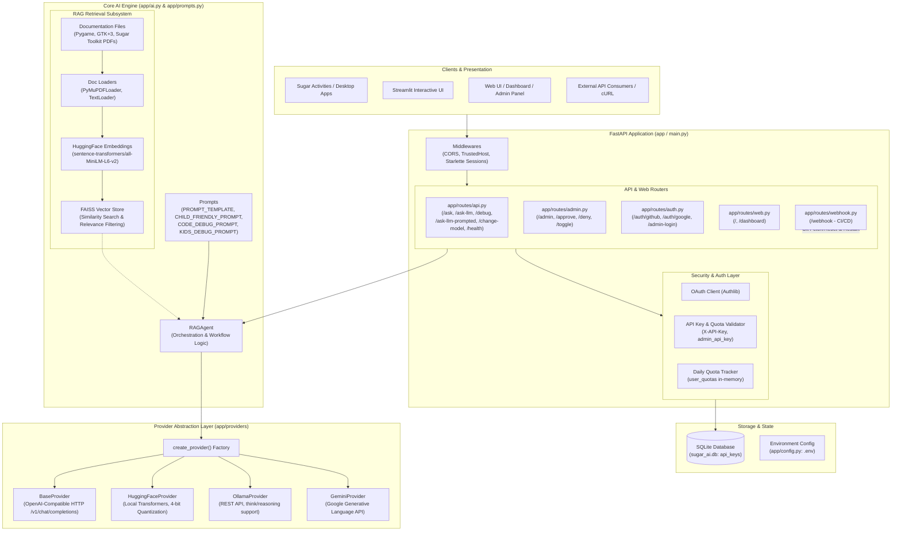
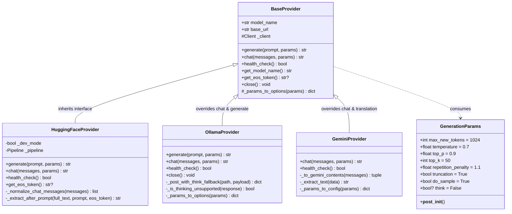
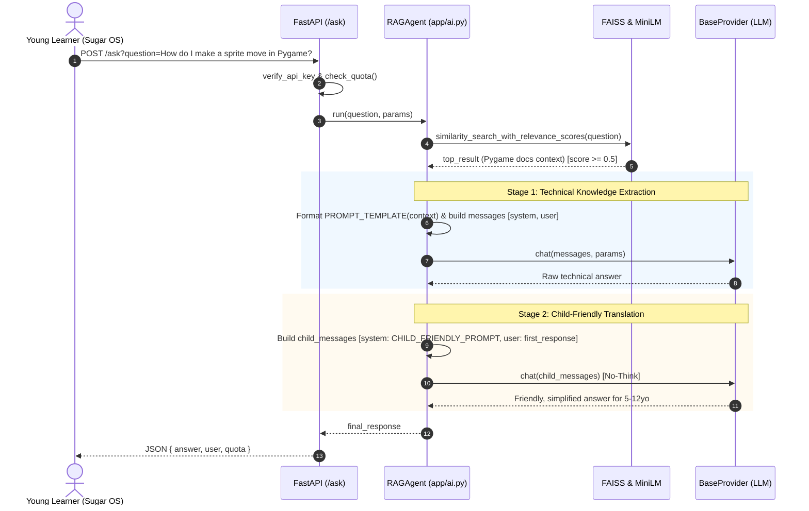
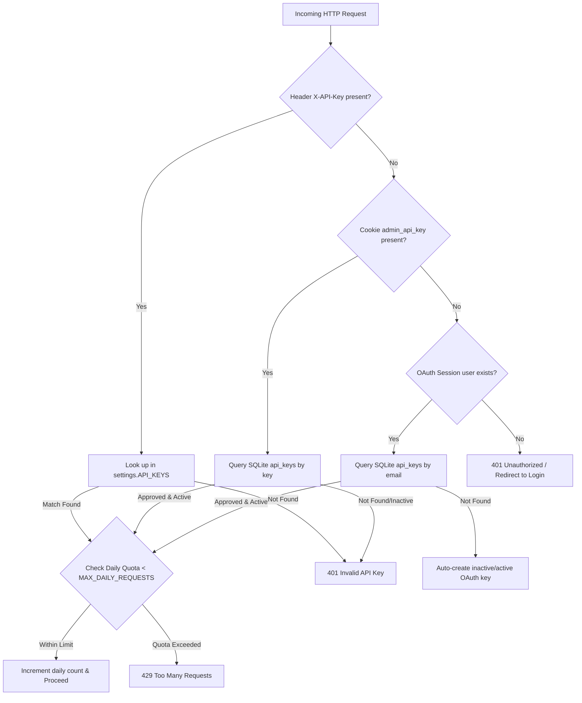

# Sugar-AI: Architecture & Codebase Guide

This document provides a comprehensive technical guide to the architecture, design patterns, data flows, and codebase structure of **Sugar-AI**.

---

## 1. Executive Summary & Purpose

**Sugar-AI** is an AI assistant service built for [Sugar Labs](https://sugarlabs.org/)—the organization behind the **Sugar Learning Platform** originally designed for the One Laptop per Child (OLPC) initiative.

The primary objective of Sugar-AI is to provide an accessible, intelligent, and child-safe coding mentor to help children (typically ages 5–12) learn Python programming, game development with **Pygame**, desktop GUI design with **Python GTK+ 3**, and activity creation using the **Sugar Toolkit**.

### Key Architectural Characteristics
* **Pedagogical Dual-Pass Pipeline**: Raw technical code analysis/debugging is performed first, and then passed through an automated child-friendly translation layer that rephrases complex concepts using encouraging tone, simple vocabulary, emojis, and clear markdown sections.
* **Retrieval-Augmented Generation (RAG)**: Built-in document vector store indexing Pygame, GTK+ 3, and Sugar Toolkit manuals so the assistant grounds its answers in official Sugar Labs ecosystem documentation.
* **Pluggable Provider Architecture**: A unified provider layer allowing Sugar-AI to run on local Hugging Face Transformers models, Ollama instances (local or remote), OpenAI-compatible hosted APIs (Groq, Cerebras, OpenRouter, Mistral), and Google Gemini.
* **Extensible Authentication & Access Control**: API Key validation, GitHub & Google OAuth login, administrative dashboards, request approval queues, and per-key daily request quotas.
* **Production & Development Modes**: Lightweight local CPU development (`DEV_MODE=1` using SmolLM2-135M) alongside production setups with 4-bit quantization, CUDA acceleration, and containerized deployment.

---

## 2. High-Level System Architecture

The following diagram illustrates the end-to-end architecture of Sugar-AI:



---

## 3. Directory & File Structure

```
SUGAR-AI/
└── sugar-ai/
    ├── app/                            # Application package root
    │   ├── __init__.py                 # FastAPI application factory (create_app)
    │   ├── ai.py                       # Core RAGAgent implementation & vector search
    │   ├── auth.py                     # Authentication logic (API keys, OAuth2 handlers)
    │   ├── config.py                   # Pydantic BaseSettings configuration
    │   ├── database.py                 # SQLAlchemy models, SQLite connection & session
    │   ├── prompts.py                  # Prompt templates (RAG, child-friendly, debug, context)
    │   ├── providers/                  # LLM backend abstraction layer
    │   │   ├── __init__.py             # Provider registry and create_provider factory
    │   │   ├── base.py                 # BaseProvider (OpenAI-compatible) & GenerationParams
    │   │   ├── gemini.py               # Google Gemini REST client implementation
    │   │   ├── huggingface.py          # Local HuggingFace Transformers pipeline
    │   │   └── ollama.py               # Ollama REST client with reasoning fallback
    │   └── routes/                     # FastAPI endpoint definitions
    │       ├── __init__.py             # Package marker
    │       ├── admin.py                # Admin panel for API key approvals & privilege toggling
    │       ├── api.py                  # Core inference endpoints (/ask, /ask-llm, /debug, etc.)
    │       ├── auth.py                 # Web authentication routes (OAuth & Admin login)
    │       ├── main.py                 # (Reserved/legacy route placeholder)
    │       ├── web.py                  # Frontend HTML routes (/, /dashboard)
    │       └── webhook.py              # GitHub HMAC webhook for automated CD redeployment
    ├── docs/                           # Documentation source PDFs for RAG
    │   ├── Pygame Documentation.pdf
    │   ├── Python GTK+3 Documentation.pdf
    │   └── Sugar Toolkit Documentation.pdf
    ├── requirements/                   # Split dependency specifications
    │   ├── base.txt                    # Shared application dependencies
    │   ├── cpu.txt                     # CPU PyTorch installation profile
    │   └── cuda.txt                    # NVIDIA CUDA 12.8 / bitsandbytes profile
    ├── static/                         # Frontend assets (CSS stylesheets and JavaScript)
    │   ├── css/                        # Modular CSS (admin, dashboard, login, welcome, etc.)
    │   └── js/                         # Vanilla JS client logic
    ├── templates/                      # Jinja2 HTML templates
    │   ├── base.html                   # Base layout
    │   ├── welcome.html                # Landing page
    │   ├── dashboard.html              # User quota & token dashboard
    │   ├── admin_panel.html            # Key management dashboard
    │   ├── admin_login.html            # API key login form
    │   ├── oauth_login.html            # Social login page (Google/GitHub)
    │   └── request_key.html            # Key application form
    ├── tests/                          # Test suite (pytest)
    │   ├── test_api_request_models.py  # Pydantic boundary validation tests
    │   ├── test_generation_params.py   # Hyperparameter post-init & sampling tests
    │   ├── test_huggingface_helpers.py # Chat template normalization & prompt extraction
    │   ├── test_provider_factory.py    # Factory instantiation & alias routing tests
    │   └── test_provider_helpers.py    # Request transformation & format mapping tests
    ├── .example.env                    # Environment variables template
    ├── docker-compose.yaml             # Docker Compose orchestration
    ├── Dockerfile                      # Multi-stage CUDA container build
    ├── main.py                         # Application entrypoint & startup orchestration
    ├── pytest.ini                      # Test runner configuration
    ├── requirements.txt                # Default entrypoint pointing to requirements/cpu.txt
    └── requirements-dev.txt            # Development & testing tools (pytest)
```

---

## 4. Deep-Dive: Core Subsystems

### 4.1 Application Initialization & Lifecycle (`main.py` & `app/__init__.py`)

The application starts from `sugar-ai/main.py`:
1. **App Creation (`create_app`)**:
   - Initialized in `app/__init__.py`.
   - Configures `SessionMiddleware` for cookie sessions (secret key from `SESSION_SECRET_KEY`).
   - Registers CORS (`*`) and `TrustedHostMiddleware`.
   - Invokes `create_tables()` to ensure SQLite schema exists.
   - Mounts static files (`/static`) and registers the five route modules (`api`, `admin`, `auth`, `web`, `webhook`).
2. **Startup Event Handler (`startup_event`)**:
   - Resolves active model precedence: `AI_MODEL` > (`DEV_MODEL_NAME` if `DEV_MODE=1` else `PROD_MODEL_NAME`).
   - Syncs static keys defined in `API_KEYS` environment variable into the SQLite database (`sync_env_keys_to_db`).
   - Calls `create_provider()` with provider name, model, and configuration flags.
   - Instantiates `RAGAgent(provider=provider)` and builds the document vector index (`setup_vectorstore`) over the files in `DOC_PATHS`.
   - Injects the active agent instance into `api.agent` and `app.state.agent`.

---

### 4.2 The Provider Abstraction Layer (`app/providers/`)

Sugar-AI abstracts model execution through a uniform interface defined in `app/providers/base.py`. This isolates application routing and RAG logic from backend inference specifics.



#### Provider Implementations Breakdown:
| Provider | Underlying Engine | Key Behaviors & Capabilities |
| :--- | :--- | :--- |
| **`BaseProvider`** | HTTP (`httpx.Client`) via `/v1/chat/completions` | Default OpenAI-compatible client. Used for OpenAI, Groq, Cerebras, OpenRouter, and Mistral. Translates `generate(prompt)` into a single user-role chat message. |
| **`HuggingFaceProvider`** | Local PyTorch & HuggingFace `transformers` pipeline | Runs directly in Python. In production with CUDA, loads models with 4-bit NormalFloat quantization via `bitsandbytes` (`BitsAndBytesConfig`). Handles role mapping (e.g. mapping `assistant` -> `model` for Gemma models) and removes echoed prompts. |
| **`OllamaProvider`** | HTTP (`httpx.Client`) to Ollama API (`/api/generate`, `/api/chat`) | Connects to local or remote Ollama servers. Features native `think` reasoning parameter support with automatic fallback: if an Ollama model rejects the reasoning flag with a 400 error, it catches it and retries transparently without `think`. |
| **`GeminiProvider`** | Google AI Studio REST API (`/v1beta/models/...:generateContent`) | Translates conversational messages into Gemini's nested `{role, parts}` schema and maps system messages into `systemInstruction`. Extracts output across candidate parts. |

#### Reasoning (`think` / no-think) & Token Headroom:
- Modern reasoning models (e.g. DeepSeek-R1, Qwen-2.5-Coder-Reasoning) generate intermediate chain-of-thought tokens.
- Sugar-AI supports an opt-in `think: bool` parameter across all generation endpoints (defaults to `False`).
- To prevent reasoning tokens from consuming the caller's entire output budget and returning an empty answer, `budget_with_headroom` dynamically adds `settings.THINKING_HEADROOM` (default: 2048 tokens) to `max_new_tokens` whenever `think=True`.

---

### 4.3 RAG & Prompt Orchestration (`app/ai.py` & `app/prompts.py`)

The core agent orchestrates document retrieval and pedagogical transformation:



#### The Two-Pass Design Pattern:
1. **Why two passes?** 
   - A single prompt asking a model to simultaneously consult complex API technical docs AND write at a 3rd-grade reading level often fails on smaller local models (e.g., 1B–7B parameter models common in schools and low-resource environments).
   - *Pass 1* extracts the technically accurate facts and code logic from the documentation.
   - *Pass 2* paraphrases the accurate answer into a welcoming, easy-to-read explanation.
2. **Code Debugging vs. Context Discovery (`/debug`)**:
   - `debug(code, context=False)`: Pass 1 uses `CODE_DEBUG_PROMPT` to analyze syntax and logic without giving away copy-paste answers; Pass 2 uses `KIDS_DEBUG_PROMPT` to reformat findings with emojis and structured sections (`## What's the Problem?`, `## Why is it a Problem?`, `## How to Fix It`).
   - `debug(code, context=True)`: Pass 1 uses `CODE_CONTEXT_PROMPT` to describe intent without critiquing; Pass 2 uses `KIDS_CONTEXT_PROMPT` to explain the program's purpose to the student and offer help.

---

### 4.4 Authentication, Quota, & Security Architecture (`app/auth.py` & `app/database.py`)

Sugar-AI implements defense-in-depth suited for educational and hosted deployments:



1. **Dual Persistence Mechanism**:
   - **Environment Variables**: Primary administrative keys are bootstrapped via the `API_KEYS` JSON string in `.env`.
   - **SQLite Database (`sugar_ai.db`)**: Stores the dynamic key table `api_keys` with fields `(id, key, name, email, can_change_model, is_active, created_at, request_reason, approved)`.
   - On startup, `sync_env_keys_to_db()` syncs `.env` keys into SQLite without overwriting existing entries.
2. **OAuth2 Integration**:
   - Built on `authlib` and Starlette `SessionMiddleware`.
   - Supports GitHub (`read:user`, `user:email`) with fallback to the GitHub user emails endpoint.
   - Supports Google OpenID Connect (`openid`, `email`, `profile`).
   - Automatically provisions a new APIKey entry on successful login.
3. **In-Memory Quota Enforcement**:
   - Tracked in `user_quotas: Dict[str, Dict]`.
   - Tracks current date and request count per key.
   - Automatically resets when `datetime.now().date()` transitions.
4. **Administrative Authorization**:
   - Users with `can_change_model=True` can access `/admin`, approve/deny key requests submitted via `/request-key`, and switch the global running model at runtime via `/change-model` (which requires both the admin key and `MODEL_CHANGE_PASSWORD`).

---

### 4.5 Continuous Deployment Webhook (`app/routes/webhook.py`)

For automated server deployments, Sugar-AI provides a secure GitHub webhook endpoint:
1. Validates the `X-Hub-Signature-256` header using HMAC-SHA256 (`hmac.compare_digest`) against `WEBHOOK_SECRET`.
2. Executes git commands against `REPO_PATH_LOCALLY` using `GIT_PATH`:
   - `git fetch origin main`
   - `git reset --hard origin/main`
3. Restarts the background systemd service via `sudo systemctl restart sugarai`.
4. If webhook variables are unconfigured, the endpoint fails gracefully with HTTP 503 instead of crashing.

---

## 5. API Reference Summary

| Endpoint | Method | Authentication | Request Format | Response Highlights |
| :--- | :--- | :--- | :--- | :--- |
| **`/`** | GET | None | None | Renders landing/welcome page (`welcome.html`). |
| **`/ask`** | POST | `X-API-Key` | Query params: `question` (str), `think` (bool, opt) | RAG-grounded child-friendly answer, user name, quota. |
| **`/ask-llm`** | POST | `X-API-Key` | Query params: `question` (str), `think` (bool, opt) | Direct unaugmented LLM answer (no document retrieval). |
| **`/debug`** | POST | `X-API-Key` | Query params: `code` (str), `context` (bool), `think` (bool, opt) | Child-friendly code explanation or debugging hints with emojis. |
| **`/ask-llm-prompted`** | POST | `X-API-Key` | JSON body: `PromptedLLMRequest` | Supports custom system prompts OR conversational multi-turn chat completions (`chat: true`), fine-grained parameters (`temperature`, `top_p`, `top_k`, `max_length`, `repetition_penalty`). |
| **`/change-model`** | POST | Admin Key | Query params: `model`, `api_key`, `password` | Re-initializes provider and switches active model on-the-fly. |
| **`/health`** | GET | None | None | Reports provider status, model name, and backend health. |
| **`/admin`** | GET | Admin Cookie/Key | None | Administrative portal to view pending, approved, and denied keys. |
| **`/admin/approve/{id}`** | POST | Admin Cookie/Key | Path param: `key_id` | Approves key and activates it in memory. |
| **`/request-key`** | GET/POST | None | Form: `name`, `email`, `reason` | Public self-service key application form. |
| **`/webhook`** | POST | HMAC-SHA256 | Header `X-Hub-Signature-256` + GitHub event body | Pulls latest Git commits and reloads systemd daemon. |

---

## 6. Development, Testing, and Deployment

### 6.1 Configuration (`.env`)

Configuration is managed through `.env` loaded via Pydantic `BaseSettings`:
- **Model Selection Rules**:
  ```python
  active_model = AI_MODEL or (DEV_MODEL_NAME if DEV_MODE else PROD_MODEL_NAME)
  ```
- **Provider Switching**: Set `AI_PROVIDER` to `huggingface`, `ollama`, `openai`, or `gemini`, and set the corresponding API keys or URLs.

### 6.2 Dependency Profiles
Sugar-AI splits its requirements into modular profiles under `sugar-ai/requirements/`:
1. `requirements/base.txt`: Core FastAPI, LangChain, FAISS CPU, PyMuPDF, Authlib, and Pydantic packages.
2. `requirements/cpu.txt`: Base dependencies + CPU-only PyTorch build from `https://download.pytorch.org/whl/cpu`.
3. `requirements/cuda.txt`: Base dependencies + CUDA 12.6 PyTorch build + `bitsandbytes` for 4-bit model quantization.

### 6.3 Test Architecture (`tests/`)
The test suite utilizes `pytest` with mock-based provider testing:
- **`test_api_request_models.py`**: Asserts Pydantic validation boundaries on `PromptedLLMRequest` (`max_length` between 1 and 8192, temperature between 0.0 and 2.0, top-p, top-k).
- **`test_generation_params.py`**: Verifies dataclass immutability and automatic `do_sample` deduction based on temperature.
- **`test_huggingface_helpers.py`**: Tests prompt de-duplication, EOS token trimming, and model-specific role mapping (e.g. Gemma role adaptation).
- **`test_provider_factory.py`**: Verifies provider initialization, URL forwarding, parameter plumbing, and alias matching (`openai`, `openai-compatible`, `openai_compatible`).
- **`test_provider_helpers.py`**: Tests provider-specific payload translation dictionaries for Ollama, Gemini, and OpenAI standards.

### 6.4 Container Deployment (Docker & Compose)
The project includes a production-ready multi-stage Docker build:
- **Builder Stage**: Uses `nvidia/cuda:12.8.0-devel-ubuntu22.04` to install Python 3.10 and download/build wheels with retry resilience.
- **Runtime Stage**: Uses `nvidia/cuda:12.8.0-runtime-ubuntu22.04`, copying built Python wheels and application source code, running under non-buffered Uvicorn on port 8000.
- **Docker Compose**: Exposes the service on port 443 with `.env` file injection.

---

## 7. Architectural Strengths & Evolution Opportunities

### Current Strengths
1. **Clean Separation of Concerns**: RAG orchestration (`RAGAgent`) is decoupled from inference mechanisms (`BaseProvider`), making it trivial to add new LLM providers without altering prompt logic.
2. **Defensive Validation**: Strict Pydantic models prevent malformed generation requests from reaching inference backends.
3. **Child-Centric UX Design**: Two-phase prompt pipeline consistently guarantees safe, welcoming, and pedagogically sound responses.
4. **Developer Experience**: Fast local CPU setup (`DEV_MODE=1` with SmolLM2) ensures contributors do not need high-end NVIDIA GPUs to develop features.

### Recommended Evolution Opportunities
1. **Persistent Vector Store**: Currently, FAISS indexes PDF documents in memory on every startup (`setup_vectorstore`). For larger document corpora, saving and loading the FAISS index to disk (`vector_store.save_local()`) will drastically accelerate startup times.
2. **Persistent Quota Storage**: Daily quotas are stored in an in-memory Python dictionary (`user_quotas`), which resets on server restart. Moving quota counters into SQLite or Redis will guarantee rate limits survive redeployments.
3. **Asynchronous Inference**: Migrating `httpx.Client` to `httpx.AsyncClient` inside `BaseProvider`, `OllamaProvider`, and `GeminiProvider` will enhance FastAPI concurrency under heavy traffic loads.
4. **Streaming Response Support (SSE)**: Implementing Server-Sent Events (SSE) or WebSockets for `/ask` and `/ask-llm-prompted` will allow learners to see answers stream in real time, reducing perceived latency.
